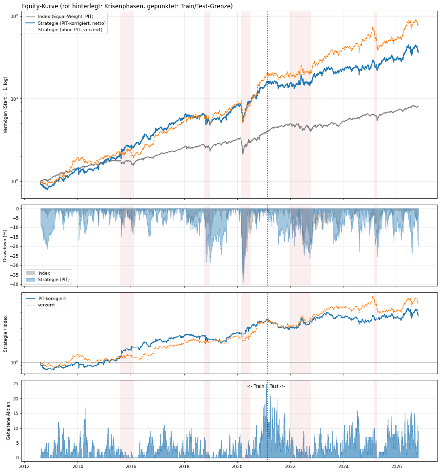
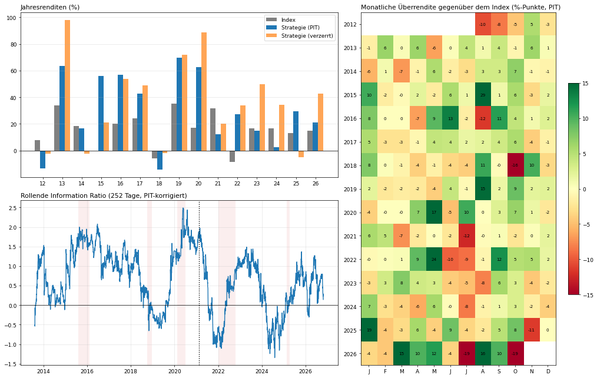

# Mean Reversion auf dem S&P 500 — vom Backtest zur ehrlichen Auswertung

Ein Lernprojekt für den Hedge Fund Club Mannheim. Es zeigt Schritt für Schritt, wie man eine Aktienstrategie nicht nur programmiert, sondern auch **ehrlich testet**: mit Transaktionskosten, Train/Test-Split, realistischer Ausführung und Korrektur von Verzerrungen, die Backtests sonst schönrechnen.

Das Projekt ist ein einziges Jupyter-Notebook (`StockScreener.ipynb`). Alle Erklärungen im Notebook sind auf Deutsch, der Code ist Englisch.

> **Kein Anlagetipp.** Das ist ein Forschungs- und Lernprojekt. Die Ergebnisse stammen aus historischen Daten mit bekannten Schwächen (siehe [Grenzen](#grenzen-und-offene-punkte)).



## Für wen ist das gedacht?

Du kannst eine Moving-Average-Crossover-Strategie programmieren: Zwei gleitende Durchschnitte, Kaufsignal beim Kreuzen, Positionen und Renditen in pandas. Dieses Projekt baut genau darauf auf und zeigt die Gegenseite, **Mean Reversion**, plus all das, was zwischen "der Backtest sieht gut aus" und "das könnte tatsächlich funktionieren" liegt.

### Crossover vs. Mean Reversion

| | MA-Crossover (Trendfolge) | Mean Reversion (dieses Projekt) |
|---|---|---|
| Annahme | Was steigt, steigt weiter | Was stark fällt, springt zurück |
| Signal | Kurzer MA kreuzt langen MA | Kurs ist ungewöhnlich weit unter seinem Normalniveau |
| Kauft | Stärke | Schwäche ("Dip") |
| Typisches Risiko | Viele Fehlsignale in Seitwärtsphasen | Fallende Messer: Der Dip war der Anfang eines Crashs |

Den MA-Gedanken brauchst Du hier trotzdem: als **Trendfilter**. Gekauft wird nur, wenn der Kurs *über* seinem 200-Tage-Durchschnitt liegt, also ein Rücksetzer im Aufwärtstrend, kein Absturz in einem Abwärtstrend.

## Die Strategie in fünf Sätzen

1. Für jede der ca. 500 S&P-500-Aktien wird täglich die **10-Tage-Rendite** berechnet.
2. Eine Aktie ist ein Kandidat, wenn diese Rendite unter **−8 %** liegt und der Kurs über dem **200-Tage-Durchschnitt** (Trendfilter).
3. Von allen Kandidaten werden nur die **2 % am stärksten überverkauften** Aktien des Tages gekauft (`top_q`). Es gibt keine feste Positionsgrenze.
4. Verkauft wird, wenn die 10-Tage-Rendite wieder über 0 % liegt, aber frühestens nach **3 Tagen** (Mindesthaltedauer, damit nicht jeder Wackler sofort Kosten erzeugt).
5. **Overlay:** Solange keine Aktie ausgewählt ist, liegt das Geld im Index (Equal-Weight aller S&P-500-Aktien). Die ausgewählten Aktien ersetzen den Indexanteil. Die Strategie wird also immer gegen "einfach den Index halten" gemessen, nicht gegen Cash.

Ausgeführt wird **zum Eröffnungskurs des Folgetags** (`next_open`): Das Signal entsteht am Schlusskurs von Tag *t*, gehandelt wird am Open von *t+1*.

## Was man hier lernen kann

Die Reihenfolge entspricht ungefähr der Reihenfolge im Notebook. Jeder Punkt war ein echter Fehler oder eine echte Erkenntnis beim Bauen.

**Transaktionskosten richtig messen.** Der klassische Fehler: die Kosten als einzelne Summe von jeder Tagesrendite abziehen. Richtig ist eine tägliche Zeitreihe: `turnover * cost_rate`, wobei der Turnover die täglichen Gewichtsänderungen sind. Die Strategie handelt oft (Turnover ca. 96× pro Jahr), deshalb entscheiden die Kosten über Erfolg oder Misserfolg.

**Feste Gewichte statt Gleichgewichtung über eine wechselnde Anzahl.** Wer jede Aktie mit `1/n` gewichtet, wobei `n` täglich schwankt, handelt jeden Tag nur wegen des Rebalancings. Deshalb gilt `w = pos / max(n, N)` mit festen Slots.

**Sharpe-Ratio korrekt.** `(mean − rf/252) / std · √252`. Die Klammern gehören um die Differenz, sonst stimmt die Operatorpriorität nicht.

**Ausführungszeitpunkt.** Wer am Schlusskurs handelt, der das Signal erzeugt hat, schaut in die Zukunft. Das Notebook vergleicht `next_close` (Handel am Folgeschluss) und `next_open` (Handel am Folgeöffnungskurs) und zeigt, wie viel Rendite die ehrliche Variante kostet.

**Train/Test-Split.** Parameter werden auf den ersten 60 % der Daten gesucht und auf den letzten 40 % geprüft. Ein Grid Search ohne Test-Zeitraum findet immer irgendetwas.

**Information Ratio statt Sharpe.** Die Strategie ist ein Overlay, also zählt die Überrendite gegen den Index: Information Ratio = annualisierte Überrendite / Tracking Error, mit t-Statistik. Dazu kommen Alpha/Beta-Regression, Calmar, Trefferquote.

**Nachbarschafts-Robustheit.** Eine einzelne Parameterkombination kann reines Glück sein. Darum wird jede Variante über 12 benachbarte Konfigurationen gemittelt (`length` 5/10 × `entry` −5/−8/−12 % × Trendfenster 100/200). Der **Mittelwert** der Nachbarn ist die ehrliche Schätzung, nicht die beste Zelle.

**Point-in-Time-Korrektur (PIT).** Das wichtigste Ergebnis, siehe unten.

## Notebook-Aufbau

| Zellen | Inhalt |
|---|---|
| 0–9 | Grundlagen: Daten laden (yfinance), `evaluate_strategy`, einfache Mean-Reversion-Strategie mit z-Score, Portfolio mit Kosten |
| 10–18 | Grid Search über Schwelle, Fenster, Trendfenster, Slots mit Train/Test-Split, Heatmaps, Equity-Kurve, Kostensensitivität |
| 19–23 | Signalvergleich: z-Score vs. RSI vs. N-Tage-Rendite, Top-Quantil-Auswahl, Overlay (15 Jahre Daten) |
| 24–29 | **Die Strategie:** Engine, Kennzahlen, Equity-Kurve, Drawdowns, Jahres- und Monatsrenditen, Krisenphasen, Trade-Log, Kostensensitivität, größte Gewinnbringer, Look-ahead-Anteil |
| 30–33 | **Forschung:** 25 Verbesserungsvarianten × 12 Nachbarn, Auswertung nach Train/Test |

`1.6 stock_screener_project.py` ist eine unabhängige Übung (Aktien-Screener in der Kommandozeile) und gehört nicht zur Strategie.

## Der wichtigste Befund: Index-Aufnahme-Bias

`sp500.csv` enthält die **heutigen** Index-Mitglieder. 214 der 503 Aktien kamen erst nach August 2012 in den Index, viele davon *weil* sie zuvor stark gestiegen waren (z. B. MRNA, CVNA, HOOD, SMCI, DECK). Wer ihre Rücksetzer vor der Aufnahme kauft, handelt mit Wissen aus der Zukunft.

Die Korrektur nutzt die Spalte `Date added`: Eine Aktie ist erst ab ihrem Aufnahmedatum handelbar und zählt erst dann zum Vergleichsindex (`pit=True`).

Ohne Korrektur entfielen **35 % der Positionstage und 51 % der Brutto-Überrendite** auf Zeiten vor der Aufnahme. Nach der Korrektur schrumpft der Vorsprung deutlich. Das Notebook zeigt beide Varianten nebeneinander.



## Ergebnisse (Stand: Daten bis Oktober 2026, 5 bps pro Seite)

Standardkonfiguration, PIT-korrigiert, Gesamtzeitraum ab 2012:

| | Index (Equal-Weight) | Strategie |
|---|---|---|
| CAGR | 15,9 % | 28,8 % |
| Volatilität | 16,2 % | 31,7 % |
| Sharpe | 0,84 | 0,88 |
| Max. Drawdown | −36,7 % | −39,0 % |
| Information Ratio | – | 0,55 (t = 2,1) |
| Beta | 1,0 | 1,15 |
| Tracking Error | – | 25,8 % |

Mehr Rendite heißt hier vor allem mehr Risiko: Der Sharpe liegt kaum über dem Index.

Die ehrlichere Zahl ist der **Mittelwert der 12 Nachbarn**: Information Ratio 0,33 (t ≈ 1,2) im Gesamtzeitraum und nur 0,09 im Test-Zeitraum ab 2021. Die Standardkonfiguration ist ein guter Zug aus dieser Nachbarschaft. Dass sie nachträglich mit Blick auf die Daten gewählt wurde, ist ein Auswahleffekt.

**Krisenphasen** (Strategie vs. Index): Die Strategie ist kein Krisenschutz. Sie gewinnt in der Erholung nach Abverkäufen (2015/16: +23 % vs. −12 %; Erholung 2020: +67 % vs. +38 %) und im schleichenden Bärenmarkt 2022 (−2 % vs. −20 %). In schnellen V-förmigen Einbrüchen verliert sie dagegen mehr als der Index (Q4 2018, Covid-Crash, Zollschock 2025).

**Kosten sind der kritische Punkt.** Überrendite der Standardkonfiguration: +18,4 Prozentpunkte bei 0 bps, +12,9 bei 5 bps, +7,5 bei 10 bps, −2,5 bei 20 bps pro Seite. Realistische Kosten bei Interactive Brokers liegen vermutlich bei 1–4 bps (Spread dominiert die Gebühr), aber das sollte man mit eigenen Ausführungsdaten prüfen.

**Verbesserungsversuche:** Eine Mindesthaltedauer von 5 Tagen kombiniert mit einer Ausstiegsschwelle von +4 % hebt den Nachbarschaftsmittelwert auf IR 0,42 (Test: 0,29) und senkt den Turnover von 98× auf 68×. Positionsobergrenzen senken den Tracking Error, verbessern aber die IR nicht. Kein Trendfilter, volatilitätsbereinigtes Signal, RSI und Ausführung zum Folgeschluss waren schlechter.

## Erweiterung: 50%-Overlay auf den SPY (beste getestete Variante)

Ordner `research/`. Ziel: den S&P 500 (SPY, Total Return) schlagen, mit höherer Sharpe Ratio. Getestet wurden die Repo-Strategie, Long/Short-Varianten und weitere Ansätze (Cross-Sectional-Momentum, Low-Vol, Trend- und Vol-Timing auf dem SPY, Kombinationen), 17 Strategien in Summe.

**Beste getestete Variante: das 50%-Overlay.** Das Repo-Signal bleibt unverändert (10-Tage-Rendite < −8 %, Kurs > SMA200, Top-2 % überverkauft, Exit bei 10-Tage-Rendite > 0, Mindesthaltedauer 3 Tage). Der Mean-Reversion-Sleeve bekommt aber höchstens **50 %** des Kapitals, gleichgewichtet auf die aktiven Aktien. Der Rest liegt im SPY, ohne Signal sind es 100 % SPY. Die 50 % wurden vorab festgelegt (Vorschlag aus den offenen Punkten), nicht auf den Ergebnissen gewählt. Sie hat unter allen getesteten Strategien die höchste Out-of-Sample-Sharpe.

Aufbau: Signal am Close t−1, Handel am Open t, 5 bps pro Seite auf Aktien, 1 bp auf SPY, Cash zum T-Bill-Satz (^IRX), PIT-Universum über `Date added`. In-Sample 2000–2012, Out-of-Sample 2013–2026. Sharpe jeweils über T-Bill.

| | CAGR | Vol | Sharpe | Max DD | Beta | Alpha p.a. | Excess CAGR | Tracking Error | Info Ratio |
|---|---|---|---|---|---|---|---|---|---|
| **In-Sample 2000–2012** | | | | | | | | | |
| SPY | +1,68 % | 21,4 % | 0,09 | −55,4 % | 1,00 | – | – | – | – |
| MR-Overlay 50 % | +7,72 % | 26,3 % | 0,34 | −52,0 % | 1,08 | +6,79 % | +6,05 % | 12,6 % | 0,55 |
| **Out-of-Sample 2013–2026** | | | | | | | | | |
| SPY | +14,76 % | 16,1 % | 0,82 | −32,0 % | 1,00 | – | – | – | – |
| MR-Overlay 50 % | +23,28 % | 21,8 % | 0,99 | −33,1 % | 1,11 | +6,82 % | +8,53 % | 12,6 % | 0,65 |
| **Voll 2000–2026** | | | | | | | | | |
| SPY | +8,22 % | 18,9 % | 0,41 | −55,4 % | 1,00 | – | – | – | – |
| MR-Overlay 50 % | +15,48 % | 24,1 % | 0,64 | −52,0 % | 1,09 | +6,91 % | +7,26 % | 12,6 % | 0,60 |

Out-of-Sample außerdem: Sortino 1,30 (SPY 0,99), Calmar 0,70 (SPY 0,46), Upside-Capture 117 %, Downside-Capture 110 %. Das Overlay schlägt den SPY in 19 von 27 Kalenderjahren (Out-of-Sample 10 von 14).

**Statistische Absicherung (Δ Sharpe gegen SPY, Block-Bootstrap, 20 Tage, 5000 Ziehungen):**

| | Δ In-Sample [95 %-KI] | P (Δ ≤ 0) | Δ Out-of-Sample [95 %-KI] | P (Δ ≤ 0) |
|---|---|---|---|---|
| 25 % | +0,14 [+0,01; +0,28] | 0,021 | +0,14 [−0,03; +0,29] | 0,053 |
| **50 %** | +0,25 [−0,00; +0,48] | 0,028 | +0,16 [−0,14; +0,43] | 0,132 |
| 75 % | +0,32 [−0,02; +0,63] | 0,033 | +0,14 [−0,25; +0,49] | 0,225 |
| 100 % (Repo "all-in") | +0,36 [−0,04; +0,73] | 0,038 | +0,11 [−0,34; +0,52] | 0,310 |

Das Out-of-Sample-Konfidenzintervall des 50%-Overlays enthält die Null: Die höhere Sharpe ist in den Daten sichtbar, aber nicht statistisch gesichert.

**Kosten (50 %, Out-of-Sample):**

| Kosten pro Seite | CAGR | Sharpe | Excess CAGR | Δ Sharpe | P |
|---|---|---|---|---|---|
| 0 bps | +25,93 % | 1,08 | +11,17 % | +0,26 | 0,043 |
| 2 bps | +24,86 % | 1,05 | +10,10 % | +0,22 | 0,069 |
| 5 bps | +23,28 % | 0,99 | +8,53 % | +0,16 | 0,132 |
| 10 bps | +20,70 % | 0,89 | +5,94 % | +0,07 | 0,329 |
| 20 bps | +15,68 % | 0,70 | +0,92 % | −0,13 | 0,817 |

Der Turnover beträgt 43,7x pro Jahr (Kosten 1,94 % p.a. bei 5 bps). Bei 20 bps pro Seite ist der Vorsprung weg.

**Nachbarschaft (12 Konfigurationen aus Länge 5/10, Einstieg −5/−8/−12 %, Trendfenster 100/200):** Out-of-Sample liegt die Sharpe im Mittel bei 0,81 (Spanne 0,62–1,01, SPY 0,82), der Excess-CAGR ist bei 11 von 12 positiv, die Sharpe liegt aber nur bei 5 von 12 über dem SPY.

**Schwache Jahre gegenüber dem SPY:** 2006 (−13,0 pp), 2007 (−10,4 pp), 2024 (−12,1 pp), 2021 (−7,8 pp), 2012 (−7,0 pp).

**Andere getestete Ansätze (Out-of-Sample 2013–2026):** Alle liegen bei Δ Sharpe ≤ 0,01 gegenüber dem SPY, mit Ausnahme der Repo-Varianten ohne Skalierung.

| Strategie | CAGR | Sharpe | Δ Sharpe |
|---|---|---|---|
| MR Long/Short (20+20 Slots, Idle SPY) | +11,96 % | 0,60 | −0,22 |
| SPY + MR marktneutral | +14,57 % | 0,67 | −0,15 |
| XS-Momentum 12-1 long (Top-Dezil) | +17,38 % | 0,77 | −0,06 |
| SPY + Momentum Long/Short | +12,76 % | 0,61 | −0,21 |
| Low-Vol long (unteres Quintil) | +12,18 % | 0,83 | +0,00 |
| SPY Trend (SMA200) | +11,12 % | 0,80 | −0,02 |
| SPY Vol-Target 15 % | +14,39 % | 0,79 | −0,03 |
| MR long (20 Slots) + Momentum-Buch als Idle | +17,44 % | 0,74 | −0,08 |

**Einschränkungen dieser Auswertung:**

- Survivorship-Bias: Das Universum sind die heutigen Mitglieder. Die PIT-Korrektur entfernt den Aufnahme-Bias, nicht die fehlenden entfernten Aktien. Vor 2012 sind nur ca. 170–290 Aktien handelbar, die In-Sample-Zahlen sind davon besonders betroffen.
- Die Repo-Parameter wurden auf Daten ab 2012 gewählt. Für diese Strategie ist 2000–2012 das echte Hold-out, 2013–2026 ist es nicht im strengen Sinn.
- Multiple Testing: 17 Strategien, 24 Nachbar-Konfigurationen und mehrere Kostenläufe. Die P-Werte berücksichtigen das nicht.
- Die 5-bps-Annahme ist gesetzt. Die Strategie ist kostenempfindlich (siehe Tabelle).
- Das Overlay hat ein Beta von 1,11 und 12,6 % Tracking Error: Die Mehrrendite kommt mit mehr Risiko als der SPY.

**Dateien in `research/`:**

| Datei | Inhalt |
|---|---|
| `overlay50.py` | 50%-Overlay inkl. Skalierung 25/75/100 %, Kosten, Nachbarschaft |
| `sp500_research.py` | Repo-Replikation, Long/Short, Momentum, Low-Vol, Trend, Vol-Target, Kombinationen |
| `momentum_overlay.py` | Time-Series-Momentum (Moskowitz/Ooi/Pedersen 2012) mit RSI(2)-Sleeves auf S&P-500-Aktien |
| `overlay_spy.py` | RSI(2)-Overlay auf SPY und Sektor-/Index-ETFs |
| `download_sp500_ohlc.py`, `download_sp500_daily.py` | Kursdownload (yfinance), legt Cache in `research/data/` ab |
| `results/` | Kennzahlen als CSV und Charts der Läufe |

Ausführung aus dem Ordner `research/`: erst `python download_sp500_ohlc.py`, dann `python overlay50.py`. Die Skripte schreiben ihre Ausgaben in `research/*_results/` (nicht versioniert), die mitgelieferten Ergebnisse liegen in `research/results/`. Voraussetzung: pandas, numpy, matplotlib, yfinance.

## Grenzen und offene Punkte

- **Survivorship Bias der entfernten Aktien.** Aktien, die aus dem Index geflogen oder delistet sind, fehlen komplett. Beim Dip-Kaufen wirkt das zugunsten der Strategie, der echte Wert liegt eher unter den ausgewiesenen Zahlen.
- **Multiple Testing.** Hunderte getestete Varianten erhöhen die Chance auf Zufallstreffer. Die t-Statistiken berücksichtigen das nicht.
- **Der Vergleichsindex ist nicht handelbar.** Ein Equal-Weight-Index aus 500 Aktien ist ein Rechenkonstrukt; ein ETF wie RSP käme dem nahe, hat aber eigene Kosten.
- **Hohe Konzentration.** Im Schnitt werden nur 4–6 Aktien gleichzeitig gehalten, der Tracking Error liegt bei ca. 26 %.
- **Datenqualität.** Die Kurse kommen von yfinance (`auto_adjust=True`). Für ernsthafte Arbeit bräuchte man einen kostenpflichtigen Datensatz mit historischen Index-Mitgliedern.

Sinnvolle nächste Schritte: historische Index-Konstituenten, Walk-Forward-Test mit mehreren Splits statt einer 60/40-Teilung, Risikoskalierung (z. B. nur 50 % Overlay), realistische Kostenmodelle.

## Installation und Ausführung

```bash
git clone <repo-url>
cd <repo-ordner>
python -m venv .venv
.venv\Scripts\activate        # macOS/Linux: source .venv/bin/activate
pip install -r requirements.txt
jupyter notebook StockScreener.ipynb
```

Beim ersten Ausführen von Zelle 20 lädt das Notebook 15 Jahre Kurse (Open und Close) aller S&P-500-Aktien über yfinance und speichert sie als `close_15y.csv` / `open_15y.csv`. Das dauert einige Minuten. Die Zellen 22 und 31 (Grid Search) brauchen jeweils ca. 2 Minuten.

Mitgelieferte Daten:

- `aktien_daten.csv`: 4 Jahre Schlusskurse, für die ersten Zellen
- `sp500.csv`: Index-Mitglieder mit `Date added` (Stand der Erstellung; Wikipedia-Liste)

## Lizenz und Haftung

Zu Lernzwecken. Keine Anlageberatung, keine Gewähr für Richtigkeit oder Vollständigkeit. Vergangene Wertentwicklung ist kein verlässlicher Indikator für zukünftige Ergebnisse.
